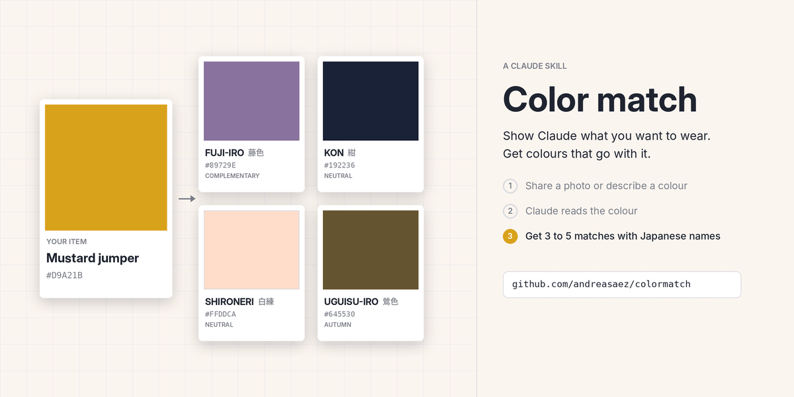

# Color match

A fun little Claude skill to help you match outfits.

You have a mustard jumper, a pair of dusty rose trousers, or a bag in a colour you love, and no idea what to wear with it. Show Claude a screenshot or describe the colour, and Color match suggests 3 to 5 colours that go with it. Each one comes with its traditional Japanese name, an English name, and a hex code.

## How it works

1. Share a photo or screenshot of the item, or describe its colour.
2. Claude reads the colour and goes straight to suggestions.
3. You get a mix of matches across four roles:
   - **Complementary:** opposite on the colour wheel, for contrast
   - **Neutral:** a calm base that lets your item lead
   - **Seasonal:** a colour suited to spring, summer, autumn, or winter
   - **Analogous:** a close neighbour, for a tonal look

You decide how the matches fit your wardrobe. Add the occasion or season if you want Claude to factor it in.

## Example

> What goes with this mustard jumper?

Mustard yellow, around #D9A21B, warm and earthy.

- **Fuji-iro (藤色)**, wisteria, #89729E, complementary. Violet sits opposite yellow and makes the mustard look richer.
- **Kon (紺)**, deep navy, #192236, neutral. A dark, classic base that lets the jumper lead.
- **Shironeri (白練)**, warm cream, #FFDDCA, neutral. Soft and light, keeps the look warm.
- **Uguisu-iro (鶯色)**, olive, #645530, autumn. Earthy and muted, a natural seasonal partner.
- **Kuchiba-iro (朽葉色)**, fallen-leaf orange, #D57835, analogous. A tonal step from mustard for a cohesive look.

Wisteria and navy give a sharper contrast. Olive and fallen-leaf orange keep it warm and tonal.

## Install

**Claude Code:** copy the `color-match` folder into `~/.claude/skills/`.

**Claude apps:** zip the `color-match` folder and upload it where you add custom skills in Claude.

Then ask Claude what goes with something you want to wear.

## The palette

The skill draws on 26 traditional Japanese colours (wa-iro), from ai-iro indigo to fuji-iro wisteria. Hex values come from Wikipedia's [Traditional colors of Japan](https://en.wikipedia.org/wiki/Traditional_colors_of_Japan) list. Sources vary on exact values for these colours, so treat them as close guides.
